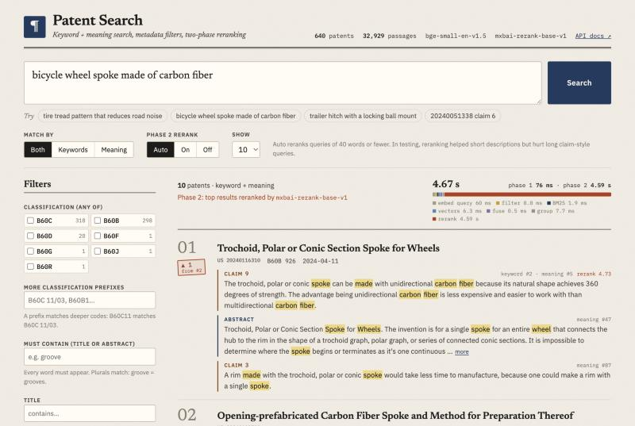

# Thinkstruct Patent Search

> **Video walkthrough of Parts 2 and 3 (2 min):** _link to be added_

| Part | What | Where |
|---|---|---|
| **1** | Hybrid search engine (keywords + meaning) with filters, and timing with/without filters | [below](#part-1-hybrid-search-filters-and-timing), [`src/patent_search/`](src/patent_search/) |
| **2** | Design for 10M patents, and a Postgres + pgvector proof of concept | [`part2_scale/DESIGN.md`](part2_scale/DESIGN.md), [`part2_scale/poc/`](part2_scale/poc/README.md) |
| **3** | Two-phase search (cross-encoder reranking), with an evaluation | [below](#part-3-two-phase-searching) |
| App | REST API (FastAPI) and a web app (React + TypeScript), all in Docker | [below](#the-web-app-and-rest-api), [`web/`](web/) |

## The problem

> **Given a patent claim, or a plain-English description of an idea, find the most similar patents and show the exact claim or description paragraph that matched, so an examiner can quickly check for overlap.**

Inputs: free text, a patent ID from the dataset (`20240051333`), or a patent ID + claim number (`20240051338 claim 6`).
Output: ranked patents (title, number, classification, date) with their **top matching passages**. Each passage is labeled ("Claim 7", "Description ¶12") and has the matched words highlighted.

## Results at a glance

- **Hybrid search** (keywords + meaning, merged by rank) beats either method alone on plain-English queries: Recall@1 **0.54** vs 0.42 (BM25 only) / 0.44 (embeddings only).
- **Filters make search faster, if done first.** On 199k passages a selective pre-filter (`CPC B60B`) cuts search time from 6.0 ms to **1.2 ms**. A naive post-filter takes 6.7 ms and returns only **1.8 of 10** results.
- **Two-phase search (Part 3)** with the `mxbai-rerank-base` cross-encoder raises plain-English Recall@1 from 0.54 to **0.63**, Recall@10 from 0.79 to **0.92** and MRR from 0.62 to **0.71**, at ~2.5 s per query on CPU.
- **But reranking badly hurts claim-length queries** (Recall@1 0.78 → 0.37). So the default `rerank="auto"` only reranks short queries, and the engine says why when it skips.

---

## Quick start

There are no API keys, and the small dataset is in the repo. Pick one:

**A. Docker (everything, one command).** Needs Docker Desktop or OrbStack.

```bash
docker compose up --build
```

- Web app: http://localhost:8080 · API docs: http://localhost:8000/docs. Postgres for the Part 2 PoC is started separately (`docker compose up -d db`, on `127.0.0.1:5432`), so a plain `up` never needs port 5432.
- The images take about 3.6 GB (API 2.9 GB with CPU-only PyTorch and both models baked in, Postgres 0.6 GB, web 80 MB). After the build it runs offline.
- **The first start builds the search index inside the container, on CPU** (Docker on a Mac has no GPU). That took 14 minutes on an M3 Pro, once (progress is in `docker compose logs api`); later starts are ready in seconds. To skip the wait, build the index with local Python (option B, ~2 min on the Apple GPU), then run `ARTIFACTS=./artifacts docker compose up`.
- Reranked searches take ~3.5–4.5 s in Docker, against ~2.5 s with local Python on the same Mac. PyTorch's Linux CPU build (which Docker uses) is slower than its macOS build; changing thread counts didn't help.

**B. Local Python** (3.12 or newer: the pinned numpy and scipy need it; tested on 3.12 / Apple Silicon). The first run downloads the models: about 130 MB for the embedder and 370 MB for the reranker.

```bash
python -m venv .venv && source .venv/bin/activate
pip install -r requirements.txt && pip install -e .

python cli.py build --dataset small        # unzips the bundled data, builds the index (~2 min)
python cli.py search "tire tread that reduces road noise"
python cli.py serve                        # REST API on http://localhost:8000 (docs at /docs)
cd web && npm install && npm run dev       # web app on http://localhost:5173 (talks to the API above)
```

### Get the data

- **Small data (required): already in the repo** as `data/patent_data_small.zip` (3 MB). `build` unzips it automatically, or you can run `python cli.py setup-data`.
- **Large data (optional bonus):** unzip `patent_data_large.zip` into `data/`, so that you have `data/coding_challenge_data/job_000/...`.

You can override the paths with `PATENT_DATA_SMALL=/path` and `PATENT_DATA_LARGE=/path`.

### Search examples

```bash
python cli.py search "spoke made of carbon fiber" --cpc B60B            # classification prefix
python cli.py search "trailer hitch locking pin" --keyword hitch --date-from 2024-06-01
python cli.py search "wheel" --title "bicycle"                           # title contains
python cli.py search "20240051338 claim 6"                               # a claim as the query
python cli.py search "20240051333"                                       # a whole patent as the query
python cli.py search "bicycle spoke made from a fabric fiber cord" --rerank on   # two-phase search
python cli.py search "bead core" --mode bm25                             # keywords only (or --mode dense)
python cli.py search "bead core" --cpc B60D --strategy post              # naive post-filter, for comparison
```

Every search prints a timing breakdown (`embed · filter · bm25 · dense · fuse · group · rerank`). Run `python cli.py search --help` to see every option.

---

## How it works

```
JSON files ─► load & clean ─► cut into passages ─► BM25 keyword index  ─┐
                                                └► embedding vectors   ─┴► saved in artifacts/

query ─► filters (lookup tables) ─► BM25 top 200 ─┐
                                 └► vector top 200 ┴► merge by rank (RRF) ─► group by patent
                                                                              └► (phase 2) rerank top 30
```

| Choice | What | Why |
|---|---|---|
| **Passages** | One passage = title + abstract, one claim, or one description paragraph (long ones are split at 250 words with overlap) | We can show exactly *which* claim or paragraph matched. The embedding model reads ~512 tokens at most. |
| **Title in front** | `"SPOKE: an axle body, ..."` | Many claims in the small data lost their opening words. The title gives that context back. |
| **Two retrievers** | BM25 (exact words) + `BAAI/bge-small-en-v1.5` embeddings (meaning) | Patents use precise terms ("bead core"), but people describe ideas in their own words. |
| **Merge by rank** | Reciprocal Rank Fusion (k = 60) | BM25 scores and cosine similarities are on different scales. RRF uses positions only, so there is nothing to tune. |
| **Group by patent** | A patent's score = its best passage (top 3 shown) | Examiners want patents, with the evidence attached. |
| **Exact vector search** | A numpy matrix, not FAISS/HNSW | 199k × 384 takes ~5 ms to scan. Approximate indexes matter at millions of passages (Part 2). |
| **Free, local models** | No API keys | Anyone can reproduce every number. |

---

## The web app and REST API



The React app shows what the engine does:
- **Highlighted passages,** each labeled ("Claim 7", "Description ¶12"), with the rank it had in each retriever (`keyword #3 · meaning #1`).
- **Phase 2:** a "▲ 4 from #5" stamp where the reranker moved a patent, and the reason when `auto` skipped reranking.
- **Timing:** a bar showing where the time went (embed, filter, BM25, vectors, fuse, group, rerank).
- **Filters:** the classification list comes from the index. Changing a filter re-runs the search (typed filters, like the title and dates, wait for a 0.4 s pause in typing), and you can switch between pre- and post-filtering to see the difference.
- **Full patent view:** clicking a passage opens the patent, scrolled to that claim or paragraph.
- **Shareable searches:** the URL holds the whole search, with the same parameters the API takes.

Starting a new search cancels the one still running, so a slow reranked answer can never replace a newer one. (The browser drops the old answer; the server still finishes computing it, which is why typed filters wait for a pause.) If a search fails, the previous results stay on screen, dimmed and labeled as old. While the API is still starting, the app keeps retrying it every 3 s.

| Endpoint | What it returns |
|---|---|
| `GET /api/search?q=...` | Ranked patents with passages, timings and filter counts. Parameters: `cpc` (repeatable, any of), `keyword` (repeatable, all of), `title`, `title_exact`, `date_from`, `date_to`, `mode` (`hybrid`/`bm25`/`dense`), `strategy` (`pre`/`post`), `kinds`, `top_k` (1–100), `rerank` (`auto`/`on`/`off`, default `auto`) |
| `GET /api/patents/{doc_number}` | One full patent: abstract, numbered claims (with what they depend on), description |
| `GET /api/facets` | Classification subclasses with counts, and the date range (for the filter panel) |
| `GET /api/health` | Index size, models loaded, available modes |

Errors:
- **400** with a readable message for a request that is valid but can't run: `"Not a valid classification prefix: '60B'"`, an unknown patent number, a backwards date range, a keyword with no searchable word in it (`"the"`, or a code like `"B60B"`, which belongs in the classification filter);
- **404** for an unknown patent;
- **422** for wrong parameter types.

Interactive docs are at `/docs`. The API is a thin layer (`create_app(engine)`) over the same engine the CLI uses.

---

## Part 1: hybrid search (filters) and timing

Filters: classification prefix (`B60B`, `B60C 11/03`; any of several), keywords that must all appear in the title/abstract, title contains / equals, and a date range.

**Pre-filter vs. post-filter.**
- `pre`: lookup tables find the matching patents *first* (an inverted index for keywords, a subclass table for CPC, one joined string of all titles). Only those patents' passages are scored by the vector search. BM25 adds up the query words' columns for all passages and then keeps the matching ones; that is cheap because only passages containing a query word are touched.
- `post` (the naive way): score everything, keep the top 1,000 passages, then drop the ones that fail the filter.

**Results on the 50k-patent slice of the large data** (199k passages, 16 queries × 3 runs, hybrid mode, query embedding excluded):

| Filter | Patents passing | `pre` ms | `post` ms | Results returned by `post` (of 10) |
|---|---:|---:|---:|---:|
| no filter | 49,867 | 6.02 | — | 10 |
| CPC B60B (wheels) | 20 | **1.22** | 6.67 | **1.8** |
| CPC B60C + keyword "tread" | 21 | **1.25** | 6.37 | **1.4** |
| CPC B60 + from 2024 | 114 | **1.44** | 7.00 | 4.8 |
| keyword "vehicle" | 2,374 | **2.25** | 9.50 | 9.6 |
| title contains "wheel" | 133 | **2.35** | 6.49 | 3.8 |
| CPC G06F (computing) | 2,601 | **2.95** | 7.11 | 6.6 |

Embedding the query adds ~9 ms (CPU) to every search, in every row. Full tables: [`benchmarks/timing_large50.md`](benchmarks/timing_large50.md) and [`benchmarks/timing_small.md`](benchmarks/timing_small.md).

**What this shows**
- **A selective pre-filter is 3–5× faster than no filter**, because it skips most of the scoring work.
- **The naive post-filter is slower than no filter, and it is wrong.** Most of the top 1,000 passages are filtered away, so it often returns only 1–5 of the 10 results. This is the classic "post-filtering kills recall" problem.
- **On the small data (640 patents, 33k passages), filters barely matter.** A whole search takes ~2 ms either way.

**Bonus: keywords + filters on all 457,385 large-data patents** (title + abstract, keyword-only index, no embeddings; [`benchmarks/timing_large_all_kw.md`](benchmarks/timing_large_all_kw.md)):

| Filter | Patents passing | `pre` ms | `post` ms | Results returned by `post` (of 10) |
|---|---:|---:|---:|---:|
| no filter | 457,385 | 1.99 | — | 10 |
| CPC B60B (wheels) | 190 | **0.48** | 2.39 | 2.7 |
| CPC B60C + keyword "tread" | 204 | **0.36** | 2.35 | 1.6 |
| CPC B60 + from 2024 | 1,150 | **1.20** | 2.84 | 5.9 |
| keyword "vehicle" | 20,885 | **0.83** | 5.65 | 9.6 |
| CPC G06F (computing) | 24,438 | 2.70 | 2.53 | 6.0 |
| title contains "wheel" | 1,268 | 9.13 | 2.43 | 4.8 |

- **Keyword search stays fast at 461k passages (~2 ms).** A BM25 query only touches the passages that contain its words. The vector scan is the part that grows with the data: ~5 ms at 199k passages means ~250 ms at 10M, which is why Part 2 needs an approximate vector index.
- **"Title contains" is the one filter that is still a scan** (9 ms over 25 MB of title text). At this size it is slower than not filtering. At 10M patents it would need a trigram index, which is what Postgres `pg_trgm` does.
- **With BM25 only, a narrow filter can return fewer than 10.** Only patents that contain at least one query word get a score.

**What we did to make it efficient**
1. **Pre-filter with lookup tables**, intersecting the smallest set first, so the work shrinks quickly.
2. **A tiny query planner.** If most rows pass (a broad filter), score everything and pick the passing scores, instead of copying most of the vector matrix. This cut a broad filter on the small data from 8.8 ms to 2.9 ms.
3. **Title search on one joined string with a regex scan** (C speed) instead of a Python loop over titles: 5.3 → 0.9 ms on 50k patents.
4. **BM25 weights precomputed** in a sparse matrix. A query is a sum of a few columns, so its cost depends on how many passages contain the query words, not on the total.
5. **`argpartition`** for top-k: O(n) instead of a full sort.
6. **Passages stored contiguously per patent**, so "patents → their passages" is range arithmetic, with no Python loop.
7. **The query is embedded on the CPU.** It is steady at ~9–14 ms. The Apple GPU is similar on average but spiked to 90–200 ms on each new query length.

**What we would do at 10M patents** (Part 2 has the details): an approximate vector index (HNSW / IVF-PQ) that supports filters, compressed vectors (int8 / product quantization), bitmap indexes for filters, and splitting the index by classification.

**Build times:**
- **Small data:** loading 0.7 s, BM25 1.1 s, embedding 106 s (Apple GPU).
- **Large slice:** loading 22 s, BM25 12 s, embedding 26 min (GPU shared with other jobs). For this slice we embed title + abstract + *independent* claims only: 199k passages instead of 1M, which would take ~3 h on a laptop.
- **All 457k (keyword-only):** loading 75 s, BM25 21 s, 2.5 GB RAM.

---

## Part 3: two-phase searching

**Which enhancement and why:** I applied for a full-stack role, which the PDF pairs with two-phase searching. It also improves result quality, the core of Thinkstruct's product, and it runs on the small dataset.

**How it works:**
1. **Phase 1:** hybrid search returns candidate patents with their best passage.
2. **Phase 2:** a **cross-encoder** reads the query and each top-30 passage *together* and scores how well they match. Patents are re-sorted by that score.

The embedding model reads the query and passage *separately*, which is fast but less precise. The cross-encoder is much more precise and much slower, so it only runs on the top 30. Each patent's old rank is kept ("was #14, now #2").

**Why 30 candidates and not the PDF's "~100 → 30":** we measured both ([`benchmarks/reranker_sweep.md`](benchmarks/reranker_sweep.md)). Reranking the top 100 gave the same Recall@1 and MRR as reranking the top 30, at about 3× the cost, so the default reranks 30. The PDF's exact setup is one flag away:

```bash
python cli.py search "bicycle spoke made from a fabric fiber cord" --rerank on --rerank-candidates 100 --top-k 30
# API: /api/search?q=...&rerank=on&rerank_candidates=100&top_k=30
```

### How we measured it (two tasks, no human labels)

| Task | Queries | What is searched | Correct answer |
|---|---|---|---|
| **plain**: plain-English idea → patent | 48 one-sentence descriptions in everyday words ([`benchmarks/plain_english_queries.jsonl`](benchmarks/plain_english_queries.jsonl)) | the normal index (all passages) | the patent the sentence describes |
| **claims**: claim → its own description (claim mapping) | 519: the first independent claim of every patent with a description | description paragraphs only, indexed *without titles* | the patent the claim came from |

The plain-English queries were **written by the AI assistant (Claude) that helped build this project**. It read each patent's title + abstract for a fixed sample (every 13th patent) and wrote one sentence per patent, avoiding the patent's own wording. They are committed, so anyone can rerun the test.

**Plain-English → patent** ([`benchmarks/eval_plain.md`](benchmarks/eval_plain.md)):

| Setup | Recall@1 | Recall@10 | Recall@30 | MRR | Median ms |
|---|---:|---:|---:|---:|---:|
| BM25 only | 0.417 | 0.667 | 0.792 | 0.514 | 3.7 |
| Embeddings only | 0.438 | 0.854 | 0.917 | 0.587 | 4.0 |
| Hybrid (RRF) | 0.542 | 0.792 | 0.917 | 0.620 | 5.0 |
| Hybrid + rerank `ms-marco-MiniLM-L-6-v2` | 0.500 | 0.854 | 0.917 | 0.617 | 266 |
| **Hybrid + rerank `mxbai-rerank-base-v1`** | **0.625** | **0.917** | 0.917 | **0.710** | 2,536 |

**Claim → its own description** ([`benchmarks/eval_claims.md`](benchmarks/eval_claims.md)):

| Setup | Recall@1 | Recall@10 | Recall@30 | MRR | Median ms |
|---|---:|---:|---:|---:|---:|
| **BM25 only** | **0.825** | **0.911** | 0.921 | **0.859** | 4.8 |
| Embeddings only | 0.713 | 0.881 | 0.909 | 0.774 | 4.9 |
| Hybrid (RRF) | 0.778 | 0.906 | 0.919 | 0.826 | 6.1 |
| Hybrid + rerank `ms-marco-MiniLM-L-6-v2` | 0.522 | 0.751 | 0.919 | 0.602 | 260 |
| Hybrid + rerank `mxbai-rerank-base-v1` | 0.372 | 0.622 | 0.919 | 0.463 | 2,513 |

*Recall@k = share of queries whose correct patent is in the top k. MRR = average of 1 / rank of the correct patent. Times are per query on CPU, excluding the query embedding.*

### What we learned

- **The reranker helps short, natural-language queries**: +8 points Recall@1, +12 Recall@10 and +0.09 MRR. It ranked the right patent higher for 15 queries and lower for 6. The well-known ms-marco cross-encoders, trained on short web questions, did **not** help. We compared 4 models and several settings; see [`benchmarks/reranker_sweep.md`](benchmarks/reranker_sweep.md).
- **The reranker hurts claim-length queries.** A claim reuses its own description's exact words, which BM25 rewards. A cross-encoder judges "is this passage about the same thing?", and many related patents are. A spot check of 40 claims: the reranker lost a patent that hybrid search had at #1 17 times, and every time its new #1 was a *different* invention in the same subclass (only 0.09–0.37 word overlap with the right patent's description), not a near-duplicate. Giving it 512 tokens instead of 256 did not help, so this isn't a truncation problem.
- **So the default is `rerank="auto"`:** rerank when the query has 40 words or fewer. Plain-English queries are at most 24 words, while 93% of claims are longer than 40. When it skips, the response says why. `on` and `off` are still available.
- **Settings, chosen by measurement:** the top **30** patents, **1** passage each, **256** tokens, on the **CPU** in **float32**. More candidates, passages or tokens cost more and added nothing. The model is saved in float16, which CPUs run 4–8× slower, so we load it in float32 explicitly.
- **Honest limits:**
  - There is one correct patent per query; real prior-art search has several, so these numbers understate quality.
  - The plain-English set is small (48 queries; one query = 2 points), and its queries were written by an AI, not by examiners.
  - The claims task favors exact word overlap by design. It also measures claim → *its own* patent, not claim → *other* similar patents (the prior-art use case), so skipping reranking for claims rests on a proxy.
  - The reranker and its settings were chosen on the same 48 queries reported here (there is no held-out set), so the gain is likely optimistic. 15 better vs 6 worse is p ≈ 0.08 on a two-sided sign test.

---

## Part 2: scale to 10M patents

[`part2_scale/DESIGN.md`](part2_scale/DESIGN.md) is the plan:
- the parts and why each was chosen;
- the backfill, weekly-update and re-embed pipelines;
- errors, using the real ones we saw in the data;
- status tracking, cost, and the hard parts.

**The key numbers:**
- **140 passages per patent** (measured): 10M patents ≈ 1.4 billion passages, or 2.15 TB of float32 vectors.
- **The main cost decision:** embed only abstracts + claims (205M vectors, 79 GB as int8). Descriptions stay keyword-searchable only.
- **Rough monthly cost:** ~$2.2–3.6k.

**Proof of concept** ([`part2_scale/poc/`](part2_scale/poc/README.md)), Postgres + pgvector in Docker:
- **Real batch files become jobs** in an `ingest_jobs` table, and each file loads in one transaction:
  - parse, clean and dedupe;
  - upsert patents;
  - embed;
  - `COPY` the passages.
- **Failed files** are retried 3 times and then left `failed` with their error, and parallel workers are safe (`SKIP LOCKED`).
- **On 10 large-data files** (9,991 patents, 40k passages), one SQL query does filters + vector search in 1–10 ms. Postgres makes the same choice as our Part 1 planner:
  - broad filter: walk the HNSW index while filtering (4–6 ms vs 34–53 ms exact);
  - narrow filter: filter first, then exact distances.

```bash
docker compose up -d db
python cli.py pg-load --dataset large --max-files 10     # or: docker compose --profile poc run --rm poc
python cli.py pg-search "battery pack with liquid cooling" --cpc H01M
python cli.py pg-status
```

---

## Data decisions

The PDF asks us to document how we handle missing fields. The rule: in prior-art search, **missing a relevant patent is worse than showing one with less text**, so we keep patents whenever we can.

| Problem | What we do |
|---|---|
| Empty description (119 of 640 in the small data) | Keep. Search title, abstract and claims; marked `has_description = false`. |
| `"N/A"` classification (38% of the large data) | Keep. It can't match a classification filter, and the response reports how many were excluded. |
| `"N/A"` title (9% of the large data) | Keep. Shown as "(no title)". |
| Duplicate document numbers (13,615 copies = 2.9% of the large data) | Keep one copy (the one with the most text). |
| Broken records / files (none found in a full scan) | Skip with a warning and count them; never crash the load. |
| `"(canceled)"` claims, blank paragraphs | Dropped. |
| Claims that lost their number / opening words (small data) | The number is inferred; the patent title is added in front when indexing. |
| Small-data CPC codes have no `/` (`B60B2700FI`) | Subclass filters are exact; deeper levels (`B60B 27/00`) are best effort. |

The full large-data load: 471 files, 0 bad, 471,000 records → **457,385 unique patents**, in 3.6 minutes (`python cli.py data-report --dataset large`).

---

## Code layout and tests

```
src/patent_search/     one small module per job
  config.py            paths, models, constants (all overridable by env vars)
  setup_data.py        safely unzip the bundled small data
  cpc.py               parse + match classification codes (both formats)
  clean.py             text cleanup, claim numbering, canceled/dependent claims
  tokenizer.py         one tokenizer for BM25, keyword filters and highlighting
  load.py              read files, "N/A" → missing, dedupe, load report
  chunk.py             patents → passages
  bm25.py              keyword index on a sparse matrix
  embed.py             embedding models (+ an offline hashing embedder for tests)
  vectors.py           exact vector search with a tiny query planner
  fusion.py            top-k + Reciprocal Rank Fusion
  filters.py           pre-filter (lookup tables) and post-filter (per-patent check)
  index.py             build / save / load everything
  results.py           the shapes a search returns
  search.py            the engine: phase 1 + optional phase 2
  rerank.py            cross-encoder reranking (+ an offline stand-in for tests)
  evaluate.py          Part 3 tasks and metrics
  benchmark.py         Part 1 timing
  loader.py            build an index from data / load one into a ready engine
  api/                 REST API: schemas.py (JSON shapes), convert.py, app.py (create_app)
  pg/                  Part 2 PoC: schema.sql, rows.py (pure), store.py (Postgres), ingest.py
  cli.py               setup-data / data-report / build / search / serve / benchmark / evaluate / pg-*
web/src/               React + TypeScript
  api/                 typed client + types mirroring the API schemas
  lib/                 pure helpers: URL <-> search state, highlighting, formatting
  hooks/               useSearch (cancels stale searches), useResource
  components/          SearchBar, FilterPanel, ResultCard, TimingBar, PatentView, ...
docker/, web/Dockerfile, docker-compose.yml    api + web (nginx) + db (pgvector)
part2_scale/           DESIGN.md and the PoC write-up
tests/unit/            one test file per module
tests/integration/     full pipeline, CLI, API, evaluation, benchmark, Postgres, real-data checks
```

```bash
pytest                    # 235 unit + integration tests, ~2 s, no model download (5 Postgres tests skip)
pytest -m slow            # also check the two real models (downloads them)
pytest -m postgres        # the PoC against real Postgres (needs PATENT_PG_DSN, see part2_scale/poc)
cd web && npm test        # 56 web app tests (Vitest + Testing Library)
docker compose run --rm api pytest     # the Python tests inside the container
```

The Python tests use a tiny fake dataset written in **both** real formats (`tests/conftest.py`), plus offline stand-ins for the models (a word-hashing embedder and a word-overlap reranker). So every module can be tested on its own, quickly:
- **The API** is tested through FastAPI's test client.
- **The PoC pipeline** is tested against an in-memory store, with a broken file and a flaky embedder, and again against real Postgres.
- **The web app** is tested against a fake API client.

---

## Reproduce every number

```bash
python cli.py build --dataset small                                    # artifacts/small
python cli.py benchmark --dataset small                                # benchmarks/timing_small.md
python cli.py evaluate --task plain  --rerankers cross-encoder/ms-marco-MiniLM-L-6-v2 mixedbread-ai/mxbai-rerank-base-v1
python cli.py evaluate --task claims --rerankers cross-encoder/ms-marco-MiniLM-L-6-v2 mixedbread-ai/mxbai-rerank-base-v1

# Part 2 PoC (needs `docker compose up -d db`)
python cli.py pg-load --dataset large --max-files 10
python cli.py pg-search "battery pack with liquid cooling between cells" --cpc H01M --explain

# bonus, needs the large data in data/coding_challenge_data
python cli.py data-report --dataset large
python cli.py build --dataset large --max-files 50 --no-description --independent-claims-only --index artifacts/large50
python cli.py benchmark --index artifacts/large50                      # benchmarks/timing_large50.md
python cli.py build --dataset large --embedder none --no-description --no-claims --index artifacts/large_all_kw
python cli.py benchmark --index artifacts/large_all_kw                 # benchmarks/timing_large_all_kw.md
```

Numbers in this README come from an Apple M3 Pro (18 GB). Timings will differ on other machines; quality numbers should match.
