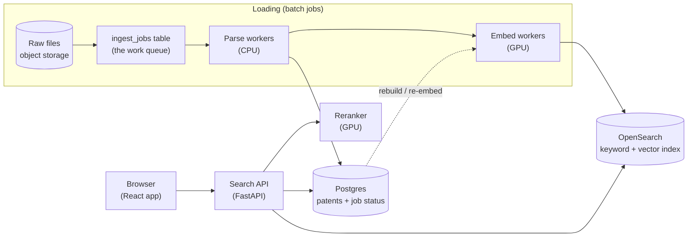

# Part 2: Patent search for 10 million patents

This is a plan you could start building from. It keeps the search behaviour from Parts 1 and 3 (keyword + meaning search, filters, a reranker for short queries) and changes how the data is stored and loaded, so it can grow from 640 patents to 10 million.

A small working version of the storage and loading part is in [`poc/`](poc/README.md) (Postgres + pgvector, loading real batch files from the large data).

---

## 1. Summary



- **Postgres is the source of truth.** It holds every patent's cleaned text and metadata, plus the job table that tracks loading.
- **OpenSearch serves searches.** One index does keyword search (BM25), vector search (HNSW) and filters, so a query needs only one round trip.
- **Loading is a queue of jobs, one per input file.** Workers take jobs from a Postgres table. Every job's state is visible, failed jobs are retried, and running a file twice does no harm.
- **Not every passage gets a vector.** Abstracts and claims are embedded; description paragraphs are keyword-searched only. That decision cuts the vector index about 7×, and it is the biggest cost decision in this doc (§3).

---

## 2. What it has to do

| Need | Detail |
|---|---|
| Size | 10M patents to start, about 7,000 more every week (new US applications are published each Thursday) |
| Search | Free text, a pasted claim, or a patent number. Keyword + meaning (hybrid), then rerank short queries (Part 3) |
| Filters | Classification code prefix (`B60B`, `B60C 11/03`), words in title/abstract, title contains / equals, publication date range |
| Speed | Phase 1 (search + filters) under ~200 ms. Phase 2 (rerank) under ~300 ms more |
| Freshness | A weekly file is searchable the same day |
| Operations | You can always answer "what is loaded, what failed, and why" |

---

## 3. The numbers that drive the design

Measured on 20 batch files of the large data (19,972 patents):

| Per patent | Count | Avg words |
|---|---:|---:|
| Title + abstract passage | 1.0 | 118 |
| Claims | 19.5 (2.76 independent) | 53 |
| Description paragraphs | 119.5 | 83 |
| **All passages** | **140** | 79 |
| Raw text | 65,600 characters | |

Scaled to 10M patents, with 384 numbers per vector (`bge-small`, the model from Part 1):

| What gets a vector | Vectors | float32 | int8 (4× smaller) |
|---|---:|---:|---:|
| Everything | 1.40 B | 2.15 TB | 540 GB |
| **Abstract + all claims (recommended)** | **205 M** | 315 GB | **79 GB** |
| Abstract + independent claims | 38 M | 58 GB | 14 GB |

Why **abstract + all claims**:
- Claims are what a patent protects, and they are what examiners compare. In our claims evaluation (Part 3), long claim-style queries were matched best by keyword search, so descriptions keep full keyword coverage without vectors.
- A vector index has to sit in memory to be fast. 79 GB fits on a few normal servers; 540 GB needs a large cluster.
- **Has to be measured before committing:** our plain-English evaluation set searches the description too. Step 2 of the build order (§12) re-runs it with description vectors removed. If recall drops, embed descriptions too, compressed harder (binary vectors are 48 bytes each: 67 GB for all 1.4 B).

Other sizes:
- **Raw data:** 471k patents were a 6.6 GB zip, so 10M ≈ 140 GB zipped. Object storage costs a few dollars a month.
- **Keyword index:** usually 30–50% of the raw text: roughly 200–330 GB on disk for 656 GB of text. Keyword indexes work from disk plus cache, so they do not all need to fit in memory.

---

## 4. The parts and why each was chosen

| Part | Job | Why this choice | Simpler / other option |
|---|---|---|---|
| **Object storage** (S3 or similar) | Keeps the raw input files forever | Cheap, and lets us re-run any load from scratch | A disk on one server (no backup, no parallel reads) |
| **Postgres** | Cleaned patents, metadata, `ingest_jobs` table | Transactions make "load a file fully or not at all" easy; `SKIP LOCKED` makes it a safe job queue; everyone knows SQL | A separate queue service (SQS, Kafka): more moving parts, not needed at one file per job |
| **Parse workers** (Python, CPU) | Read a file, clean, dedupe, write to Postgres | The cleaning code from Part 1 (`load.py`, `clean.py`, `cpc.py`) runs unchanged | — |
| **Embed workers** (Python, GPU) | Turn passages into vectors, write to OpenSearch | GPUs are the expensive part, so they get their own stage and are kept busy | A paid embedding API (no GPUs to manage, about 10–20× the cost, §10) |
| **OpenSearch** | BM25 + HNSW vectors + filters in one index | It supports **filtering during the vector search** (choosing exact search when the filter is narrow), the same idea as the Part 1 planner. One query does both retrievers | **pgvector** (what the PoC uses) is great up to tens of millions of vectors; 205M is past where it is comfortable. Separate keyword and vector systems means two queries and syncing two stores |
| **Search API** (FastAPI) | Parses the query, calls OpenSearch, merges results (RRF), calls the reranker | It is the API from this repo, with the in-memory index swapped for OpenSearch calls | — |
| **Reranker** (GPU) | Phase 2 for short queries (`rerank=auto`) | On CPU it takes ~2.5 s per query (measured); on one GPU, roughly 50–100 ms | Skip phase 2, or use a smaller model with lower quality |

---

## 5. Data model

**Postgres** (exactly the PoC schema: [`src/patent_search/pg/schema.sql`](../src/patent_search/pg/schema.sql)):

- `patents`: one row per document number, with cleaned fields: title, abstract, parsed classification (`cpc_subclass`, `cpc_group`, `cpc_subgroup`), `pub_date` / `pub_year`, `source_file`, and `text_size`. Claims and description go in a JSON column, or in a `passages` table as in the PoC.
- `ingest_jobs`: one row per input file, with status (`pending` / `running` / `done` / `failed`), attempts, counts (records, bad records, duplicates, patents written, passages) and the last error.

**OpenSearch:** one document per passage, carrying the patent's filter fields so filtering happens inside the index:

```json
{
  "doc_number": "20240051338", "kind": "claim", "label": "Claim 6",
  "text": "a tread portion extending in a tire circumferential direction ...",
  "title": "PNEUMATIC TIRE",
  "cpc_subclass": "B60C", "cpc_path": ["B", "B60", "B60C", "B60C11", "B60C11/03"],
  "pub_date": "2024-02-15", "pub_year": 2024,
  "embedding": [0.012, -0.034, ...]          // only for abstract + claim passages
}
```

- `cpc_path` lists every prefix of the code, so a prefix filter becomes an exact term match, which is the fastest kind of filter.
- `title` gets an n-gram sub-field, so "title contains" is an index lookup instead of the full scan we do in Part 1 (9 ms at 457k patents would be ~200 ms at 10M).
- Index aliases (`patents-live` → `patents-v3`) let us rebuild into a new index and switch over instantly (§6.3).

---

## 6. Pipelines

### 6.1 Backfill (the first 10M)

1. **Queue:** list every file in object storage and insert one `ingest_jobs` row per file (`ON CONFLICT DO NOTHING`, so listing twice is harmless).
2. **Parse** (many CPU workers in parallel). Each worker loops:
   - claim a job with `FOR UPDATE SKIP LOCKED`, so no two workers take the same file;
   - parse, clean and dedupe with the Part 1 code;
   - upsert into `patents`, keyed by document number. A copy only replaces a stored patent if it has more text;
   - mark the job `parsed`, all in one transaction.
3. **Embed** (GPU workers). Take parsed jobs, chunk the patents written by that job, embed the abstract + claim passages in large batches, and bulk-write all passages to OpenSearch. Check every item in the bulk response, retry the failures, then mark the job `done`.
4. **Check:** compare counts (`patents` rows vs. distinct `doc_number`s in OpenSearch), then run the evaluation sets from Part 3 against the new index before it serves traffic.

How long it takes, roughly:
- **Parsing:** on one core our parser reads and cleans all 471k large-data records in 80 s (metadata only) to 214 s (all text). So 10M is about 30–75 core-minutes. Not the bottleneck.
- **Embedding:** 205M passages of ~105 tokens with `bge-small`. One data-center GPU does a few thousand such passages per second, so that is about **15–20 GPU-hours** (≈ 2–3 hours on 8 GPUs). Embedding all 1.4B passages would be about 7× that.

### 6.2 Weekly update (every Thursday)

The same pipeline with one file of about 7,000 patents:
- A scheduler (cron or Airflow) drops the new file in object storage and queues one job.
- Parse plus embed takes minutes. New documents get new IDs; a re-published document replaces its old version (same key), so the update is idempotent.
- After the job is `done`, a quick check runs 20 fixed queries and compares them with last week's results. An alert fires if more than a few change.

### 6.3 Re-embed (new embedding model)

You can't mix vectors from two models in one index, so we never re-embed in place:
1. Create a new index (`patents-v4`) with the new model's vector size.
2. Re-run step 3 of the backfill over all `done` jobs, reading from Postgres (no re-parsing). The live index keeps serving the whole time.
3. Run the Part 3 evaluation on both indexes. Switch the alias only if the new one is at least as good.
4. Keep the old index for a week for instant rollback, then delete it.

The same blue-green swap covers changing the chunking or the mapping.

---

## 7. One search, step by step

| Step | Where | Budget |
|---|---|---|
| Parse query; expand a patent number into its text (as in `resolve_query`) | API | 1 ms |
| Embed the query (`bge-small`, CPU is fine for one query) | API | 10–15 ms (measured) |
| One OpenSearch request: BM25 top 200 + filtered k-NN top 200 (abstract + claims), filters applied inside both | OpenSearch | 30–100 ms |
| Merge with RRF, group passages by patent (MaxP), as in `search.py` | API | 1–3 ms |
| Phase 2 if the query is 40 words or fewer: rerank the top 30 patents, 1 passage each, 256 tokens | Reranker GPU | 50–100 ms |
| Fetch titles and dates for the page | Postgres or the index | 5 ms |

**Filters and vector search together** are the hard part. When a filter keeps very few patents (say, one CPC subgroup), an approximate vector index can run out of matching neighbours and return too few results. That is the same failure our naive post-filter showed in Part 1: 1.8 results instead of 10. The fix is the Part 1 planner idea:
- **narrow filter:** score the few matching passages exactly;
- **broad filter:** walk the index and skip non-matching items.

OpenSearch's k-NN "efficient filtering" makes this choice per query. In the PoC, pgvector's `hnsw.iterative_scan` keeps walking the graph until enough rows pass the filter.

---

## 8. Errors and what we do about them

These come from the real data we loaded, not made-up cases:

| What goes wrong | Seen in our data | What the system does |
|---|---|---|
| Missing values written as the text `"N/A"` | 38% of large-data classifications, 9% of titles | Treated as missing when parsing. The patent is still loaded and searchable; it can't match a classification filter, and the API says how many patents were left out for that reason (`excluded_no_cpc`) |
| Same patent in several files | 13,615 extra copies in 471k records (2.9%) | Upsert by document number; the copy with the most text wins. Counted as `duplicates` in the job row |
| Bad record (not an object, no number) | Our tests include them | Skipped and counted (`bad_records`); the rest of the file loads |
| Broken file (cut-off JSON) | Our tests include one | The job fails with the error text. It is retried up to 3 times, then stays `failed` (the "dead letter" list) for a person to look at |
| Worker crashes halfway | — | The file's writes are one transaction, so nothing partial is left. A `running` job not updated for 10 minutes is taken over by another worker (a lease) |
| Embedding service down or slow | — | The job fails and is retried later with backoff. Search keeps serving the current index |
| Some OpenSearch bulk items rejected | — | Those items are retried. The job only becomes `done` when every passage is in |
| Claims missing their opening words, canceled claims, unnumbered claims | Common in the small data | Handled when parsing (`clean.py`): canceled ranges dropped, numbers inferred, the title put in front of each claim for context |
| Dates: large-data files have only the year | All large data | `pub_year` comes from the document number. A date filter treats it as Jan 1–Dec 31 of that year, so prior art isn't silently dropped |

The rule throughout is **idempotency**: every step can be run again safely. The key is the document number, and a file is loaded completely or not at all.

---

## 9. Tracking the system's status

- **The `ingest_jobs` table is the dashboard's data.** The PoC's `python cli.py pg-status` prints this summary:

  ```sql
  SELECT status, count(*), sum(patents_written), sum(passages), sum(duplicates), sum(bad_records)
  FROM ingest_jobs GROUP BY status;
  -- and the failures, with their error text:
  SELECT source_file, attempts, error FROM ingest_jobs WHERE status = 'failed';
  ```

- **Metrics** (Prometheus, Grafana):
  - loading: jobs done per hour, passages embedded per second, queue length;
  - search: latency p50/p95 per stage, using the same stage names as `timings_ms` in our API (`embed`, `filter`, `bm25`, `dense`, `rerank`);
  - search: rerank on/off ratio, and the share of zero-result queries.
- **Alerts:**
  - a failed job;
  - the queue not shrinking for an hour during a backfill;
  - search p95 over budget;
  - a weekly update not `done` by Thursday evening;
  - the weekly check queries changing a lot.
- **Search health:** `GET /api/health` (already in this repo) reports the index size and loaded models. Add the index version and the time of the last completed job.

---

## 10. Cost (rough, to be checked with the cloud provider's calculator)

These are ballpark list prices meant to show where the money goes. Each line shows its formula so it can be redone with real quotes.

**One-time backfill:**

| Item | Estimate |
|---|---|
| Embedding 205M passages on rented GPUs: ~20 GPU-hours × ~$1–2/hour | **~$20–40** |
| The same with a paid embedding API: 205M × 105 tokens ≈ 21.5B tokens × ~$0.02 per million | ~$430 |
| Embedding *all* 1.4B passages: ~7× either line | ~$150–300 (GPU) / ~$3,000 (API) |
| Parsing (CPU, ~30–75 core-minutes) | ~$0 |

**Monthly:**

| Item | Size | Estimate |
|---|---|---|
| OpenSearch: about 3 memory-heavy nodes (64 GB RAM each) for ~80 GB of int8 vectors + graph, and ~300 GB of keyword index on SSD | 3 nodes | ~$1,500–2,500 |
| Postgres (managed, mid-size) | 1 | ~$150–300 |
| API servers | 2 small | ~$100 |
| Reranker: one small GPU, always on | 1 | ~$400–700 |
| Object storage (~140 GB raw + parsed copies) | | < $10 |
| **Total** | | **≈ $2,200–3,600 / month** |

Where it moves:
- **Embedding descriptions too** multiplies the vector part by ~7. The search cluster, not the GPUs, becomes the big bill.
- **No reranker** saves the GPU, but short queries lose the ~8 points of Recall@1 we measured in Part 3.
- **Low traffic:** the reranker GPU can scale to zero and fall back to phase 1 only.

---

## 11. The hard parts (honestly)

1. **Vector memory.** This is the main cost and the main risk. The "no vectors for descriptions" decision needs the measurement in §3 before we rely on it.
2. **Filters + approximate vector search.** Narrow filters can lose results (we measured it in Part 1). It needs the exact-vs-index switch, plus a test that a narrow filter still returns a full page.
3. **"Title contains"** is a full scan in our engine. At 10M it needs an n-gram (trigram) index: `pg_trgm` in the PoC, an n-gram field in OpenSearch.
4. **The reranker is slow without a GPU, and not always better.** It helped short plain-English queries (+8 points Recall@1) but hurt claim-length queries badly (Part 3), so `rerank=auto` has to stay, and the 40-word cutoff should be re-tested on real query logs.
5. **Measuring quality at 10M.** Our two evaluation sets (claim → own description; 48 plain-English queries) are small, and the plain-English set was written by us. Real relevance judgments from patent searchers are needed before claiming quality numbers.
6. **Duplicates aren't always identical.** "The copy with the most text wins" is a guess. With kind codes (A1 vs. A2, B1) and dates, the rule should prefer the latest publication.
7. **Re-embedding takes a long time.** A model change is a multi-hour job plus an evaluation, which is why it is blue-green (§6.3) and not in place.

---

## 12. Build order (for whoever picks this up)

1. Run the PoC ([`poc/README.md`](poc/README.md)) and read `pg/ingest.py` and `pg/store.py`: the job queue, the transaction per file, the upsert rule.
2. Measure the cost decision: re-run `python cli.py evaluate --task plain` with description passages left out of the vector side. Decide on description vectors.
3. Set up OpenSearch with the mapping in §5. Port `store.search` to one OpenSearch query (BM25 + filtered k-NN + filters), keeping RRF and grouping from `search.py`.
4. Split the PoC's loader into the parse stage and the embed stage, with their own job states (`parsed`, `done`).
5. Backfill 1M patents, check counts, run both evaluation sets, and check the latencies in §7.
6. Add the weekly scheduler, metrics and alerts (§9), then backfill the rest.
7. Put the reranker on a GPU and set the latency budget.
